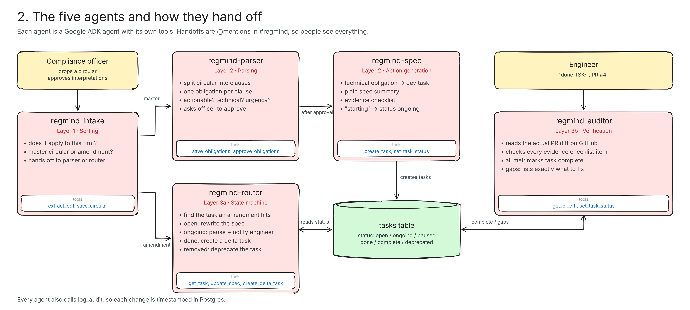
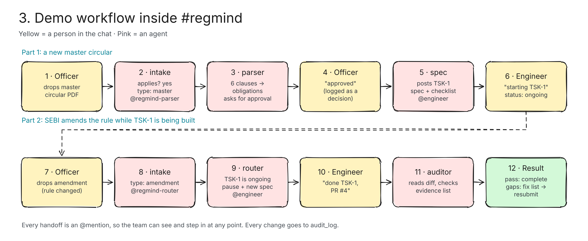

# RegMind.ai

### Your compliance team, now with AI teammates in the chat

RegMind.ai puts five AI agents inside your team chat through **Switch**. They turn SEBI circulars into engineering tasks, get a human to approve before anything moves, and check the engineer's pull request against the rule before a task is marked done.

Built for **Flip the Switch** (WeMakeDevs × DevTools Academy × Switch) · Track 01: Best Business Workflow

---

## The problem

Every time SEBI issues a circular, a stock broker has to work out what changed and build it into their systems. The rules are written in legal language, but the work is done by engineers. Today it usually goes like this:

1. A compliance officer reads a long circular and figures out what applies.
2. They explain it to engineers over calls, emails and spreadsheets.
3. Engineers build what they understood.
4. Weeks later someone checks by hand whether what got built actually meets the rule.

Things get lost at every step, and gaps only show up during an audit. Small brokers feel this the most because they don't have big compliance teams.

---

## The solution

RegMind.ai is a team of five agents that sit in the same chat room as the compliance officer and the engineers.

The officer drops a circular into the room. The agents read it, split it into obligations, and ask the officer to approve. Approved technical obligations become engineering tasks with a plain-English spec and an evidence checklist. When an engineer finishes, they ask the auditor to review their pull request, and the auditor reads the real code on GitHub and checks it against the checklist.

Everything happens in the conversation, so everyone sees what the agents are doing and can step in at any point. People make the decisions. The agents do the reading, the translating and the checking.

---

## Meet the agents

| Agent | What it does |
|---|---|
| **regmind-intake** | Reads a new circular (PDF, DOCX, image or text), decides if it applies to the firm, and registers it. Hands it to the parser. |
| **regmind-parser** | Splits the circular into clauses and classifies each one: technical, business, prohibitive, governance or informational, plus urgency. Asks the compliance officer to approve. After approval it splits the list into work for engineering and work for the compliance team. |
| **regmind-spec** | Turns each approved technical obligation into an engineering task (TSK-001, TSK-002, ...) with a spec and an evidence checklist, and tracks when an engineer starts it. |
| **regmind-router** | Handles amendments to an earlier circular. Finds the tasks a changed rule affects and updates them based on their current status. |
| **regmind-auditor** | Reads the engineer's pull request from GitHub, masks any secrets in it, and checks every item on the task's evidence checklist. Marks the task complete or lists exactly what's missing. |

Agents hand work to each other by @mentioning the next agent in the room, the same way a person would.





---

## The workflow (what the demo shows)

Everything below happens in one Mattermost channel connected through Switch, with a compliance officer, an engineer and the five agents.

**1. A circular arrives**

> **Compliance officer:** @regmind-intake new SEBI circular, please review *(attaches master_circular.txt)*
>
> **RegMind Intake:** Read Master Circular on Log Retention and Access Control for Stock Brokers. It applies to us. Type: master circular.
> @regmind-parser please extract obligations from circular_id=1
>
> **RegMind Parser:** Extracted 15 clauses from circular 1:
> • OBL-004 · 3.1 · technical · urgent · Retain order management system logs for a minimum of 2 years
> • OBL-005 · 3.2 · technical · urgent · Store OMS logs in WORM storage
> • ...
> 4 technical items will become engineering tasks. Compliance officer, please review and reply "approved".

**2. A human approves**

> **Compliance officer:** @regmind-parser approved
>
> **RegMind Parser:** 15 obligations approved.
> To engineering: 3.1 log retention, 3.2 WORM storage, 4.1 MFA, 4.3 session timeout
> For the compliance team: quarterly report, appoint a Technology Compliance Officer, annual board review, no shared credentials
> @regmind-spec please create engineering tasks for circular_id=1
>
> **RegMind Spec:** Created 4 engineering tasks:
> TSK-001 · urgent · Retain OMS logs for 730 days.
> Evidence: retention_days set to 730 in the logging config · automated test showing logs can't be deleted early

**3. An engineer picks up a task and opens a PR**

> **Engineer:** @regmind-spec starting TSK-001

The engineer opens a pull request on GitHub ([example PR](https://github.com/AnshuRoy25/regmind-demo-broker/pull/1)).

**4. The auditor checks the real code**

> **Engineer:** @regmind-auditor review PR #1 for TSK-001
>
> **RegMind Auditor:** ✅ TSK-001 verified against PR #1 and marked complete.
> • retention_days set to 730 in config/logging.yaml ✓
> • automated test verifying log deletion is prevented in tests/test_log_retention.py ✓

If something is missing, the auditor says exactly what, for example "retention_days is 365 in config/logging.yaml, needs to be 730", and the task stays open until a fixed PR passes.

---

## How Switch is used

Switch is the backbone of RegMind.ai. Without it the agents would have no shared place to work with people, and the project would not work.

- **Agents are registered on Switch.** On setup, our backend calls Switch's Agent Protocol to register all five agents (`regmind-intake`, `regmind-parser`, `regmind-spec`, `regmind-router`, `regmind-auditor`), each with its own API key, display name and avatar. Their addressing policy is set to open so anyone in the room can talk to them.
- **One room for people and agents.** The backend creates a **Compliance Office** room on Switch and adds the five agents. Switch links that room to a Mattermost channel. The compliance officer and engineers join the channel; the agents are already there.
- **Live stream in, HTTP out.** The backend holds a WebSocket connection to Switch as `regmind-intake` and receives every message in the room, including file attachments, which it downloads through Switch's media API. Replies are posted back into the room as the right agent over HTTP.
- **Agents hand off by @mention.** A small orchestrator reads the mentions in each message, runs the mentioned agent, posts its reply, and follows any handoff (intake → parser → spec), with a hop limit so agents can't loop.
- **Humans stay in control.** Nothing reaches engineering until a person approves in the chat, and engineers drive their own tasks by talking to the agents.
- **Runs on Mattermost.** The team works in Mattermost, which comes bundled with Switch. Because the agents talk to Switch and not to Mattermost directly, the same room could be moved to Slack, Teams or Discord without changing the agents.

Our agents are custom **Google ADK** agents using **Gemini**, connected to Switch through its Agent Protocol.

---

## When a rule changes (amendments)

SEBI often amends a circular while the work is already in progress. When an amendment changes an existing clause, `regmind-router` looks at the live status of each affected task:

| Task status | What RegMind does |
|---|---|
| Not started | Rewrites the spec. |
| In progress | Pauses the task and tells the engineer what changed. |
| Already done | Creates a separate change task for just the difference. |
| Rule withdrawn | Deprecates the task. |
| New clause added | Creates a new obligation for regmind-spec. |

This decision is made in plain Python, not by the model, so it behaves the same way every time. A sample amendment is in `samples/amendment_circular.txt`.

---

## Under the hood

- **Reliable where it matters.** Splitting a circular into clauses, task state changes and amendment decisions are plain Python. The model is used for reading, classifying, writing specs and checking evidence.
- **Validated tool calls.** If an agent passes a wrong section number or category, the tool rejects it and the agent corrects itself, so bad data isn't saved.
- **Clear task states.** Tasks move through open → ongoing → done → complete, with paused and deprecated for amendments. Invalid moves are blocked.
- **Secrets never reach the model.** Before a PR diff is sent to Gemini, API keys, tokens, passwords, private keys, emails and IP addresses are replaced with placeholders.
- **Audit trail.** Every agent action and approval is logged with a timestamp.

---

## Tech stack

- **Agents:** Google ADK with Gemini (`gemini-3.5-flash-lite`)
- **Team chat:** Switch (self-hosted on Railway) with Mattermost
- **Backend:** FastAPI (Python)
- **Database:** PostgreSQL with SQLAlchemy and Alembic
- **Documents:** PyMuPDF, python-docx and Tesseract OCR for reading circulars
- **Code checks:** GitHub API for pull request diffs

---

## Project structure

```
RegMind/
├── app/
│   ├── agents/
│   │   ├── definitions/     # the 5 ADK agents
│   │   ├── prompts/         # one prompt file per agent
│   │   ├── tools/           # circular, obligation, task and GitHub tools
│   │   ├── orchestrator.py  # @mention routing and agent handoffs
│   │   ├── runtime.py       # ADK runner, one session per room and agent
│   │   └── guardrails.py    # secret masking for PR diffs
│   ├── integrations/switch/
│   │   ├── provisioner.py   # registers agents and creates the room on Switch
│   │   ├── supervisor.py    # WebSocket listener, attachment download
│   │   ├── agent_registry.py# posts replies as each agent
│   │   ├── protocol.py      # Switch Agent Protocol client
│   │   └── gateway.py       # Switch admin API (rooms, workspaces)
│   ├── api/routes/          # REST API under /api/v1
│   ├── models/              # SQLAlchemy models
│   ├── schemas/             # Pydantic schemas
│   ├── services/            # circular, obligation, task, audit services
│   └── main.py
├── migrations/              # Alembic migrations
├── samples/                 # demo circulars and diffs
├── requirements.txt
└── .env.example
```

---

## How to run it

### 1. Get a Switch server

Deploy the **Agent Switch** template on Railway. It starts the Switch server, Postgres and a bundled Mattermost. Note the Switch URL and the admin email and password you set during deploy.

### 2. Set up the backend

You need Python 3.11+ and PostgreSQL running locally.

```bash
git clone https://github.com/AnshuRoy25/RegMind.git
cd RegMind
python -m venv virtual
virtual\Scripts\activate          # Windows
# source virtual/bin/activate     # macOS / Linux
pip install -r requirements.txt
```

Create a database called `regmind`, then copy `.env.example` to `.env` and fill it in:

```
USER=postgres
PASSWORD=your_db_password
HOST=localhost
PORT=5432
DBNAME=regmind
SECRET_KEY=any_long_random_string   # encrypts agent API keys, don't change it after provisioning
GOOGLE_API_KEY=your_gemini_api_key
GEMINI_MODEL=gemini-3.5-flash-lite
SWITCH_URL=https://your-switch.up.railway.app
SWITCH_EMAIL=switch_admin_email
SWITCH_PASSWORD=switch_admin_password
SWITCH_AUTOCONNECT=true
GITHUB_REPO=owner/repo              # repo the auditor reads PRs from
GITHUB_TOKEN=                       # optional for public repos
```

Create the tables and start the server:

```bash
alembic upgrade head
uvicorn app.main:app
```

Check `http://localhost:8000/api/v1/health`.

### 3. Register the agents on Switch

Open `http://localhost:8000/docs` and call `POST /api/v1/switch/provision`. This registers the five agents, creates the **Compliance Office** room and adds the agents to it. The terminal should show `Loaded 5 Switch agents` and `Switch connection ready`.

Run only one backend per Switch server, because each agent allows one live connection.

### 4. Use it

1. Open the Mattermost URL from Railway and log in with the regular user account (not the admin).
2. Open the **Compliance Office** channel. The five agents greet you there.
3. Attach `samples/master_circular.txt` with `@regmind-intake new SEBI circular, please review`.
4. When the parser asks, reply `@regmind-parser approved`.
5. Start a task: `@regmind-spec starting TSK-001`.
6. Open a PR in the repo set in `GITHUB_REPO`, then: `@regmind-auditor review PR #1 for TSK-001`.

---

## What's next

- Bring a coding agent like Claude Code or Codex into the room to implement tasks, with the auditor checking its work.
- Reminders for the compliance-team obligations (quarterly reports, board reviews).
- Let the auditor comment on the PR directly on GitHub.
- Support RBI and other regulators.

---

## Team

**Team ASQUARE**

- Anshu Roy
- Aayush Dubey

*The circulars used in the demo are mock documents written for this hackathon, not real SEBI circulars.*
